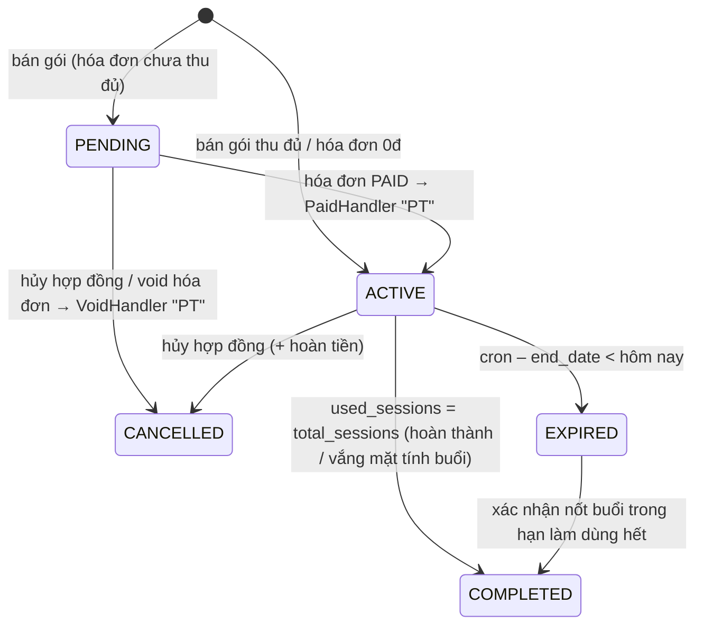
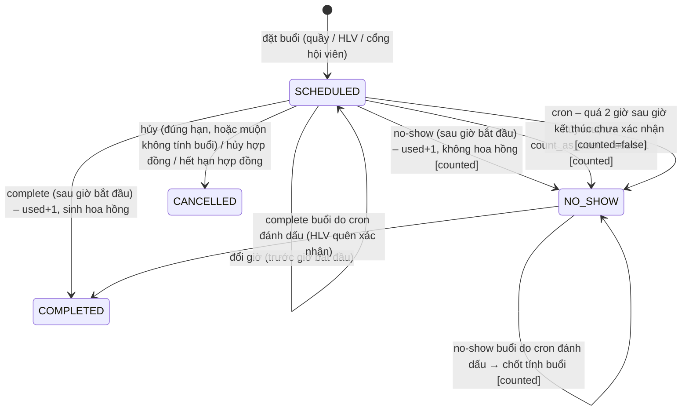

# API – Huấn luyện cá nhân (PT): hợp đồng, buổi PT, lịch dạy HLV, hoa hồng (migration 000008)

Base URL (dev): `http://localhost:8000/v1`. Mọi endpoint cần `Authorization: Bearer <access_token>`.
Envelope, mã lỗi, phân trang: xem `sprint-01-auth-rbac-branch.md`. Tóm tắt:

- Thành công: `{ "code": 0, "message": "OK", "data": ... }`.
- Lỗi: `code` 5 chữ số, HTTP status chuẩn theo bảng trong `sprint-01-auth-rbac-branch.md`, `message` tiếng Việt hiển thị thẳng cho người dùng.
  Validate tag: `code = 51` (HTTP 400). Nghiệp vụ: `40000` (400), `40300` (403), `40400` (404), `40900` (409).
- Ngày `"YYYY-MM-DD"` (lịch Việt Nam, `Asia/Ho_Chi_Minh`). Thời điểm RFC3339 (`2026-10-15T08:00:00+07:00`).
  Riêng `start_at` khi **gửi lên** chấp nhận thêm `"YYYY-MM-DDTHH:mm"` / `"YYYY-MM-DD HH:mm"` (hiểu là giờ VN).
- Tiền: `number` VND, làm tròn đến đồng. Kỳ hoa hồng: `"YYYY-MM"`.
- Danh sách phân trang: `data = {items, total, total_page, current_page, limit}`; query chung `page`, `limit` (≤100), `keyword`, `order_by`, `order_dir`.

**Phạm vi chi nhánh.** OWNER thấy toàn hệ thống. Nhân viên gắn chi nhánh chỉ xem/thao tác hợp đồng, buổi PT, hoa hồng
thuộc chi nhánh của mình; ngoài phạm vi → `40300`.

**HLV (người chỉ có vai trò `TRAINER`).** Mặc định chỉ thấy **của chính mình**: danh sách hợp đồng/buổi/hoa hồng tự lọc
`trainer_id = mình`; truyền `trainer_id` của người khác hoặc mở chi tiết hợp đồng/buổi của HLV khác → `40300`
`"Bạn chỉ được xem dữ liệu của chính mình"` / `"Bạn chỉ được xem/thao tác buổi PT của chính mình"`.
Người có thêm vai trò khác (MANAGER, RECEPTIONIST…) không bị giới hạn này.

**Audit log** (`audit_logs`): `entity = pt_contract` (action `SELL`, `ACTIVATE`, `CHANGE_TRAINER`, `CANCEL`, `EXPIRE`),
`pt_session` (`SCHEDULE`, `RESCHEDULE`, `CANCEL`, `COMPLETE`, `NO_SHOW`, `AUTO_NO_SHOW`),
`trainer_commission` (`PAY`, `entity_id` = id HLV). Hóa đơn ghi audit riêng (`invoice`).

**Thông báo in-app** (`notifications.type`): `PT_SCHEDULED` (đặt / đổi giờ buổi, đổi HLV), `PT_CANCELLED` (hủy buổi, hủy hợp đồng, vắng mặt),
`PT_NO_SHOW` (cron đánh dấu buổi quá giờ chưa xác nhận), `COMMISSION_PAID` (đã chi hoa hồng).
Gửi cho HLV liên quan (link `/admin/pt-sessions/{id}` hoặc `/admin/pt-contracts/{id}`) và hội viên **có tài khoản cổng**
(link `/member/pt-sessions`); không gửi cho chính người vừa thao tác.

## Danh sách endpoint

| Method | Path | Quyền | Mô tả |
|---|---|---|---|
| POST | `/admin/pt-contracts/quote` | `pt.sell` | Xem trước bán gói PT (không ghi DB) |
| POST | `/admin/pt-contracts` | `pt.sell` | Bán gói PT: hợp đồng + hóa đơn (+ thu tiền) |
| GET | `/admin/pt-contracts` | `pt.view` | Danh sách hợp đồng |
| GET | `/admin/pt-contracts/{id}` | `pt.view` | Chi tiết (gói, hội viên, hóa đơn, buổi tập) |
| GET | `/admin/members/{id}/pt-contracts` | `pt.view` | Hợp đồng PT của hội viên |
| POST | `/admin/pt-contracts/{id}/change-trainer/check` | `pt.sell` | Kiểm tra trùng lịch khi đổi HLV (không ghi DB) |
| POST | `/admin/pt-contracts/{id}/change-trainer` | `pt.sell` | Đổi HLV |
| POST | `/admin/pt-contracts/{id}/cancel` | `pt.cancel_contract` | Hủy hợp đồng (+ hoàn tiền) |
| GET | `/admin/pt-sessions` | `pt.view` | Lịch buổi PT theo khoảng ngày (≤ 62 ngày) |
| GET | `/admin/pt-sessions/{id}` | `pt.view` | Chi tiết buổi |
| POST | `/admin/pt-sessions` | `pt.schedule` | Đặt buổi |
| PUT | `/admin/pt-sessions/{id}` | `pt.schedule` | Đổi giờ buổi |
| POST | `/admin/pt-sessions/{id}/cancel` | `pt.schedule` | Hủy buổi |
| POST | `/admin/pt-sessions/{id}/complete` | `pt.complete` | Xác nhận hoàn thành (giáo án, nhận xét) → trừ buổi + sinh hoa hồng |
| POST | `/admin/pt-sessions/{id}/no-show` | `pt.complete` | Đánh dấu vắng mặt → trừ buổi, **không** hoa hồng |
| GET | `/admin/trainer-schedule` | `pt.view` | Lịch dạy của HLV: buổi PT + lớp nhóm |
| GET | `/admin/commissions` | `commission.view` | Danh sách hoa hồng |
| GET | `/admin/commissions/summary` | `commission.view` | Tổng hợp hoa hồng theo HLV trong kỳ |
| POST | `/admin/commissions/pay` | `commission.pay` | Chi trả hoa hồng (PENDING → PAID) của 1 HLV trong kỳ |

Quyền mặc định (migration 000008): OWNER, MANAGER có tất cả. RECEPTIONIST: `pt.view`, `pt.sell`, `pt.schedule`.
TRAINER: `pt.view`, `pt.schedule`, `pt.complete`, `commission.view` (chỉ dữ liệu của mình).

Dropdown dùng kèm: `GET /admin/pt-packages/options` (gói đang bán), `GET /admin/trainers/options?branch_id=` (HLV của chi nhánh),
`GET /admin/members/options` (hội viên), `POST /admin/promotions/check` với `applies_to = PT`.

## Enum

| Trường | Giá trị | Nhãn gợi ý |
|---|---|---|
| `contract.status` | `PENDING` · `ACTIVE` · `COMPLETED` · `EXPIRED` · `CANCELLED` | Chờ thanh toán · Đang tập · Đã dùng hết · Hết hạn · Đã hủy |
| `session.status` | `SCHEDULED` · `COMPLETED` · `CANCELLED` · `NO_SHOW` | Đã đặt · Hoàn thành · Đã hủy · Vắng mặt |
| `session.source` | `COUNTER` · `PORTAL` · `TRAINER` | Quầy · Cổng hội viên · HLV tự đặt |
| `commission.status` | `PENDING` · `PAID` | Chờ chi · Đã chi |
| `commission.source_type` | `PT_SESSION` · `CLASS` | Buổi PT · Buổi dạy lớp |

`session.counted` (boolean): buổi **đã trừ** vào hợp đồng = `COMPLETED`, hoặc `NO_SHOW` đã chốt tính buổi
(`completed_at != null`). `NO_SHOW` với `counted = false` là buổi do cron đánh dấu, **chờ quản lý xử lý** (xem §4).
Gợi ý nhãn: `NO_SHOW` + `counted=false` → "Quá giờ chưa xác nhận".

## Vòng đời

### Hợp đồng PT

- Chỉ hợp đồng `ACTIVE` được **đặt buổi mới**. Hợp đồng `EXPIRED` vẫn **xác nhận** được buổi đã diễn ra trong hạn.
- `price` = số tiền thực bán sau khuyến mãi (= `amount` của dòng hóa đơn PT). `price_per_session = round(price / total_sessions)`.

### Buổi PT

Ràng buộc DB: `EXCLUDE ex_pt_trainer_overlap` – một HLV không có 2 buổi `SCHEDULED/COMPLETED` chồng giờ.
Buổi `CANCELLED`/`NO_SHOW` không chiếm lịch.

---

## 1. Đối tượng

### `Contract` (dòng danh sách)
```json
{
  "id": 43,
  "member_id": 360, "member_code": "GM000360", "member_name": "Nguyễn Văn An", "member_phone": "0999000111",
  "trainer_id": 50, "trainer_name": "Lê Văn HLV",
  "pt_package_id": 1, "package_code": "PT10", "package_name": "PT 10 buổi",
  "branch_id": 1, "branch_name": "GymMaster Cầu Giấy",
  "invoice_id": 59, "invoice_no": "HD26101400059", "invoice_status": "PAID",
  "total_sessions": 10, "used_sessions": 1, "scheduled_sessions": 2,
  "remaining_sessions": 9, "bookable_sessions": 7,
  "session_minutes": 60,
  "start_date": "2026-10-14", "end_date": "2026-11-27",
  "price": 3500000, "price_per_session": 350000,
  "status": "ACTIVE",
  "days_left": 44,
  "sold_by": 1, "sold_by_name": "Quản trị viên",
  "note": "",
  "created_at": "2026-10-14T09:55:20+07:00", "updated_at": "2026-10-14T09:55:21+07:00"
}
```
- `remaining_sessions = total − used`; `bookable_sessions = total − used − scheduled` (còn đặt được).
- `days_left = end_date − hôm nay`, chỉ có với `PENDING/ACTIVE` (còn lại `null`).

### `ContractDetail` = `Contract` +
```json
{
  "package": { "id": 1, "code": "PT10", "name": "PT 10 buổi", "session_count": 10, "session_minutes": 60, "validity_days": 45, "price": 3500000, "status": "ACTIVE" },
  "member": { "id": 360, "member_code": "GM000360", "full_name": "Nguyễn Văn An", "phone": "0999000111", "email": "", "status": "ACTIVE" },
  "invoice": { "...": "InvoiceDetail (sales.md §3) hoặc null" },
  "sessions": [ { "...": "Session" } ]
}
```
`sessions`: mọi buổi của hợp đồng, sắp theo giờ bắt đầu.

### `Session`
```json
{
  "id": 21, "contract_id": 43,
  "trainer_id": 50, "trainer_name": "Lê Văn HLV",
  "member_id": 360, "member_code": "GM000360", "member_name": "Nguyễn Văn An", "member_phone": "0999000111",
  "branch_id": 1, "branch_name": "GymMaster Cầu Giấy", "package_name": "PT 10 buổi",
  "start_at": "2026-10-15T08:00:00+07:00", "end_at": "2026-10-15T09:00:00+07:00",
  "status": "COMPLETED", "counted": true,
  "workout_note": "Squat 5x5, bench 3x8", "trainer_note": "Tiến bộ tốt",
  "completed_at": "2026-10-15T09:05:00+07:00", "cancelled_at": null, "cancel_reason": "",
  "source": "COUNTER", "created_by": 1, "created_by_name": "Quản trị viên",
  "created_at": "...", "updated_at": "..."
}
```
- `completed_at`: thời điểm **chốt** buổi (hoàn thành hoặc chốt tính buổi vắng mặt/hủy muộn).
- `cancel_reason`: lý do hủy / ghi chú vắng mặt / lý do cron đánh dấu.

### `Commission`
```json
{
  "id": 8, "trainer_id": 50, "trainer_name": "Lê Văn HLV",
  "branch_id": 1, "branch_name": "GymMaster Cầu Giấy",
  "source_type": "PT_SESSION", "source_id": 23,
  "session_start_at": "2026-10-14T07:00:00+07:00", "contract_id": 43, "member_name": "Nguyễn Văn An",
  "base_amount": 350000, "rate": 15, "amount": 52500,
  "period": "2026-10", "status": "PENDING",
  "paid_at": null, "paid_by": null, "paid_by_name": "",
  "created_at": "..."
}
```
`session_start_at`, `contract_id`, `member_name` chỉ có với `source_type = PT_SESSION` (dòng `CLASS` → `null` / `""`).

---

## 2. Hợp đồng PT – `/admin/pt-contracts`

### POST `/admin/pt-contracts/quote` – xem trước
Body như bán gói (không có `payment`):
```json
{ "member_id": 360, "pt_package_id": 1, "trainer_id": 50, "branch_id": 1, "start_date": "", "promotion_code": "PT200K", "note": "" }
```
Response:
```json
{
  "member_id": 360, "branch_id": 1, "trainer_id": 50, "trainer_name": "Lê Văn HLV",
  "package": { "...": "PackageRef" },
  "start_date": "2026-10-14", "end_date": "2026-11-27",
  "total_sessions": 10, "session_minutes": 60,
  "subtotal": 3500000, "discount": 200000, "total": 3300000, "price_per_session": 330000,
  "promotion": { "id": 3, "code": "PT200K", "name": "Giảm 200.000đ gói PT", "discount": 200000 }
}
```
Không ghi DB, không tăng lượt dùng mã.

### POST `/admin/pt-contracts` – bán gói PT
```json
{
  "member_id": 360,
  "pt_package_id": 1,
  "trainer_id": 50,
  "branch_id": 1,
  "start_date": "",
  "promotion_code": "",
  "note": "Khách giới thiệu",
  "payment": { "amount": 1500000, "method": "CASH", "reference": "", "note": "" }
}
```
| Trường | Bắt buộc | Ghi chú |
|---|---|---|
| `member_id` | ✔ | Hội viên phải `ACTIVE` |
| `pt_package_id` | ✔ | Gói PT phải `ACTIVE` (đang bán) |
| `trainer_id` | ✔ | User `ACTIVE`, là HLV (hồ sơ `position = TRAINER` hoặc vai trò `TRAINER`), có vai trò tại `branch_id` (hoặc toàn hệ thống) |
| `branch_id` | ✔ | Chi nhánh bán, phải `ACTIVE` và trong phạm vi người bán |
| `start_date` | | ≥ hôm nay; bỏ trống = hôm nay |
| `promotion_code` | | Mã `applies_to` = `PT` hoặc `ALL` |
| `payment` | | Thu ngay: `amount` > 0 và ≤ tổng hóa đơn, `method` ∈ CASH/TRANSFER/CARD |

Trong **một transaction**: tạo hợp đồng `PENDING` (`total_sessions = session_count`, `session_minutes` của gói,
`end_date = start_date + validity_days − 1`) → lập hóa đơn qua `InvoiceService` (1 dòng `item_type = "PT"`, `ref_id` = id hợp đồng,
`AppliesTo = PT`, áp + tiêu thụ mã KM) → lưu `invoice_id`, `price` = thành tiền dòng → thu tiền (nếu có).
Thu đủ (ngay lúc bán, hoặc sau đó qua `POST /admin/invoices/{id}/payments`) → **PaidHandler "PT"** chuyển hợp đồng `ACTIVE`.
Hóa đơn bị void (chưa thu đồng nào) → **VoidHandler "PT"** chuyển hợp đồng `CANCELLED`. Response: `ContractDetail`.

Lỗi: `40000 "Hội viên đang không hoạt động"`, `"Gói PT … đã ngừng bán"`, `"HLV không thuộc chi nhánh, không phải HLV hoặc đã bị khóa"`,
`"Ngày bắt đầu không được ở quá khứ"`, `"Chi nhánh đang ngừng hoạt động"`, `"Số tiền thu vượt quá số còn nợ (…)"`, lỗi mã KM;
`40300 "Bạn không có quyền bán gói PT tại chi nhánh này"`; `40400 "Không tìm thấy hội viên" | "Không tìm thấy gói PT"`.

### GET `/admin/pt-contracts`
| Query | Mô tả |
|---|---|
| `branch_id` | Chi nhánh (ngoài phạm vi → 40300) |
| `trainer_id`, `member_id`, `pt_package_id` | |
| `status` | `PENDING` … `CANCELLED` |
| `keyword` | Tên/SĐT/mã hội viên, tên HLV, tên/mã gói, số hóa đơn |
| `order_by` | `id` (mặc định), `start_date`, `end_date`, `created_at`, `price`, `status`, `used_sessions` |

Response `{ items: Contract[], total, … }`. HLV: tự lọc hợp đồng của mình.

### GET `/admin/pt-contracts/{id}` → `ContractDetail`
`40400 "Không tìm thấy hợp đồng PT"`; ngoài phạm vi → `40300`; HLV xem hợp đồng của HLV khác → `40300`.

### GET `/admin/members/{id}/pt-contracts` → `Contract[]`
Mới nhất trước; chỉ hợp đồng thuộc chi nhánh trong phạm vi (HLV: chỉ hợp đồng của mình).

### POST `/admin/pt-contracts/{id}/change-trainer/check` · `/change-trainer` – đổi HLV
```json
{ "trainer_id": 51, "note": "HLV cũ nghỉ phép dài" }
```
- Hợp đồng `PENDING/ACTIVE`; HLV mới khác HLV hiện tại, hợp lệ tại chi nhánh của hợp đồng.
- Các buổi `SCHEDULED` **tương lai** (`start_at > now`) được chuyển sang HLV mới; mỗi buổi kiểm tra HLV mới không trùng
  buổi PT khác và không trùng lịch lớp nhóm (chưa hủy). Buổi đã qua giờ giữ HLV cũ (hoa hồng thuộc HLV cũ khi xác nhận).
- `/check` (không ghi DB) trả:
```json
{
  "ok": false, "trainer_id": 51, "trainer_name": "Trần HLV",
  "moved_sessions": 3,
  "conflicts": [
    { "session_id": 21, "start_at": "2026-10-15T08:00:00+07:00", "end_at": "2026-10-15T09:00:00+07:00", "reason": "HLV đã có buổi PT khác trùng giờ" }
  ]
}
```
  `reason`: `"HLV đã có buổi PT khác trùng giờ"` | `"HLV có lịch dạy lớp nhóm trùng giờ"`.
- `/change-trainer`: có xung đột → `40900` với danh sách trong `message`, **không đổi gì**:
  `"Không thể đổi HLV: 1 buổi đã đặt bị trùng lịch của HLV mới: buổi #21 lúc 08:00 15/10/2026 (HLV đã có buổi PT khác trùng giờ). Hãy đổi giờ hoặc hủy các buổi này trước"`.
  Gợi ý UI: gọi `/check` trước để hiển thị bảng xung đột. Thành công → `ContractDetail`; thông báo HLV cũ, HLV mới, hội viên.

### POST `/admin/pt-contracts/{id}/cancel` – hủy hợp đồng
```json
{ "reason": "Khách chuyển nơi ở", "refund": { "amount": 2800000, "method": "CASH" } }
```
- Hợp đồng `PENDING/ACTIVE` (khác → `40000 "Hợp đồng PT đã kết thúc, không thể hủy"`).
- `PENDING`, hóa đơn chưa thu đồng nào và không hoàn tiền → **void** hóa đơn (trả lượt KM) → `CANCELLED`.
- Ngược lại: hoàn tiền trước (nếu có) qua `InvoiceService.Refund` (≤ số đã thu − đã hoàn; lỗi hoàn tiền rollback cả thao tác) → `CANCELLED`.
- **Mọi buổi `SCHEDULED` còn lại** (kể cả buổi đã qua giờ nhưng chưa xác nhận) bị hủy với lý do `"Hủy hợp đồng PT: …"`.
  Muốn tính công cho buổi đã dạy → xác nhận hoàn thành **trước** khi hủy hợp đồng.
- Số tiền hoàn do người dùng nhập (gợi ý UI: `price_per_session × remaining_sessions`). Response: `ContractDetail`.

---

## 3. Buổi PT – `/admin/pt-sessions`

### GET `/admin/pt-sessions` – lịch theo khoảng ngày
| Query | Bắt buộc | Mô tả |
|---|---|---|
| `from`, `to` | ✔ | `YYYY-MM-DD`, tính cả hai đầu (giờ VN), tối đa **62 ngày** (`40000 "Khoảng thời gian xem lịch tối đa 62 ngày"`) |
| `branch_id`, `trainer_id`, `member_id`, `contract_id` | | |
| `status` | | `SCHEDULED` · `COMPLETED` · `CANCELLED` · `NO_SHOW` |

Lọc theo `start_at`. Response: **mảng** `Session[]` (không phân trang), sắp theo giờ — dùng cho lịch tuần/tháng (FullCalendar).
HLV: tự lọc buổi của mình.

### GET `/admin/pt-sessions/{id}` → `Session`

### POST `/admin/pt-sessions` – đặt buổi
```json
{ "contract_id": 43, "start_at": "2026-10-15T08:00:00+07:00" }
```
`end_at = start_at + session_minutes`. Kiểm tra theo thứ tự (trong transaction, hợp đồng bị khóa `FOR UPDATE`):
1. Hợp đồng tồn tại, trong phạm vi; HLV chỉ đặt cho hợp đồng của mình (`40300`).
2. Hợp đồng `ACTIVE` → `40000 "Hợp đồng PT chưa được kích hoạt (chưa thanh toán đủ)"` / `"Hợp đồng PT đã kết thúc, không thể đặt buổi tập"`.
3. `start_at` ở tương lai → `40000 "Giờ bắt đầu buổi tập phải ở tương lai"`.
4. Buổi nằm trong `[start_date, end_date]` → `40000 "Buổi tập phải nằm trong thời hạn hợp đồng (14/10/2026 - 27/11/2026)"`.
5. Hội viên `ACTIVE`.
6. Trong giờ mở cửa chi nhánh, cùng một ngày → `40000 "Buổi PT phải nằm trong giờ mở cửa của chi nhánh (05:30 - 22:00)"`.
7. **Hạn mức buổi:** `used_sessions + số buổi SCHEDULED < total_sessions`
   → `40000 "Hợp đồng đã đặt/dùng hết số buổi (đã dùng 1, đang đặt 9 / tổng 10 buổi)"`.
8. Trùng lịch → `40900`:
   - `"HLV đã có buổi PT khác trùng giờ"` (kiểm tra trước + **EXCLUDE 23P01** khi 2 request đồng thời lọt qua);
   - `"HLV có lịch dạy lớp nhóm trùng giờ"` (`class_schedules` chưa hủy của HLV);
   - `"Hội viên đã có buổi PT khác trùng giờ"`;
   - `"Hội viên đã đặt lớp nhóm trùng giờ"` (`class_bookings` `BOOKED/ATTENDED` của lớp chưa hủy).

`source`: `TRAINER` nếu người đặt là HLV của hợp đồng, ngược lại `COUNTER`. Thông báo `PT_SCHEDULED` cho HLV và hội viên có tài khoản cổng.
Response: `Session`.

### PUT `/admin/pt-sessions/{id}` – đổi giờ
Body `{ "start_at": "2026-10-17T07:00" }`. Buổi phải `SCHEDULED` và **chưa bắt đầu** (`40000 "Buổi tập đã bắt đầu, không thể đổi giờ"`);
giờ mới theo đúng quy tắc 2–4, 6, 8 ở trên (không tính chính buổi đó khi xét trùng). Thông báo `PT_SCHEDULED`.

### POST `/admin/pt-sessions/{id}/cancel` – hủy buổi
```json
{ "reason": "Khách báo ốm", "count_as_used": false }
```
Chỉ buổi `SCHEDULED`. Hạn hủy = `start_at − pt.cancel_before_minutes` (cấu hình, mặc định 720 phút = 12 giờ).
| Thời điểm hủy | `count_as_used` | Kết quả |
|---|---|---|
| ≤ hạn hủy (đúng hạn) | bỏ qua | `CANCELLED`, không trừ buổi |
| > hạn hủy (muộn, kể cả sau giờ bắt đầu) | `false` | `CANCELLED`, không trừ buổi (quầy châm chước) |
| > hạn hủy | `true` | `NO_SHOW`, `counted = true`, `used_sessions + 1`, **không** hoa hồng |

Trừ buổi mà dùng hết → hợp đồng `COMPLETED`. Thông báo `PT_CANCELLED`.

### POST `/admin/pt-sessions/{id}/complete` – xác nhận hoàn thành
```json
{ "workout_note": "Squat 5x5, bench 3x8", "trainer_note": "Tiến bộ tốt" }
```
- Chỉ **sau giờ bắt đầu** (`40000 "Chỉ xác nhận được sau giờ bắt đầu buổi tập"`).
- HLV chỉ xác nhận buổi **của mình** (`40300`); quản lý xác nhận được mọi buổi trong phạm vi.
- Buổi `SCHEDULED`, hoặc `NO_SHOW` do cron đánh dấu (`counted = false`). Đã `COMPLETED` → `40900 "Buổi tập đã được xác nhận hoàn thành"`;
  `NO_SHOW` đã tính buổi → `40900`; đã hủy → `40000`.
- Hợp đồng `ACTIVE` hoặc `EXPIRED` và còn buổi (`used < total`).
- Trong **một transaction**: khóa hợp đồng `FOR UPDATE` → khóa buổi → `used_sessions + 1` (dùng hết → `COMPLETED`)
  → buổi `COMPLETED` + ghi chú → **sinh `trainer_commissions`**:
  - `source_type = PT_SESSION`, `source_id` = id buổi, `branch_id` = chi nhánh buổi;
  - `base_amount = round(contract.price / total_sessions)` (giá/buổi theo số tiền thực bán);
  - `rate = staff_profiles.commission_rate` của HLV dạy buổi (0 nếu chưa có hồ sơ – vẫn sinh dòng 0đ để đếm buổi);
  - `amount = round(base_amount × rate / 100)`;
  - `period` = tháng (giờ VN) của **giờ bắt đầu buổi**, dạng `YYYY-MM`.
  - `UNIQUE(source_type, source_id)` chống tính trùng → `40900 "Buổi tập đã được tính hoa hồng"`.
- Hai request hoàn thành đồng thời cùng buổi: request sau chờ khóa hợp đồng, đọc lại buổi đã `COMPLETED` → `40900`
  (đã có integration test). Response: `Session`.

### POST `/admin/pt-sessions/{id}/no-show` – vắng mặt
Body `{ "note": "Không đến, không báo" }` (mặc định `"Hội viên vắng mặt"`). Điều kiện như `complete` (sau giờ bắt đầu, buổi `SCHEDULED`
hoặc NO_SHOW chưa tính). **Lựa chọn nghiệp vụ:** vắng mặt **tính là đã dùng buổi** (`used_sessions + 1`, `counted = true`)
nhưng **không sinh hoa hồng** cho HLV. Thông báo `PT_CANCELLED` cho hội viên.

### GET `/admin/trainer-schedule` – lịch dạy HLV (PT + lớp nhóm)
Query: `trainer_id` (bỏ trống = chính mình), `from`, `to` (bắt buộc, ≤ 62 ngày). HLV chỉ xem lịch của mình.
```json
[
  { "type": "CLASS", "id": 12, "title": "Yoga cơ bản", "start_at": "2026-10-15T07:00:00+07:00", "end_at": "2026-10-15T08:00:00+07:00",
    "status": "SCHEDULED", "branch_id": 1, "branch_name": "GymMaster Cầu Giấy", "trainer_id": 50, "trainer_name": "Lê Văn HLV",
    "contract_id": null, "member_id": null, "room_name": "Phòng Yoga", "color": "#F97316", "booked_count": 8, "capacity": 20 },
  { "type": "PT", "id": 21, "title": "PT – Nguyễn Văn An", "start_at": "2026-10-15T08:00:00+07:00", "end_at": "2026-10-15T09:00:00+07:00",
    "status": "SCHEDULED", "branch_id": 1, "branch_name": "GymMaster Cầu Giấy", "trainer_id": 50, "trainer_name": "Lê Văn HLV",
    "contract_id": 43, "member_id": 360, "room_name": "", "color": "", "booked_count": null, "capacity": null }
]
```
Gồm buổi PT (trừ `CANCELLED`) và buổi lớp chưa hủy; sắp theo giờ. Nhân viên gắn chi nhánh chỉ thấy mục thuộc chi nhánh của mình.

---

## 4. Tác vụ định kỳ (cron) – `service.PTService`

Lấy service qua `module.PTServiceOf(d)` (cùng instance mà module PT dùng; xem §6).
```go
// Hợp đồng ACTIVE có end_date < today (ngày VN) → EXPIRED (audit EXPIRE); hủy các buổi SCHEDULED bắt đầu
// SAU ngày hết hạn. Buổi trong hạn chưa xác nhận giữ nguyên để HLV/quản lý xác nhận. Trả số hợp đồng đã hết hạn.
ExpireContracts(ctx context.Context, today time.Time) (int, error)

// Buổi SCHEDULED có end_at < now − 2 giờ (quá giờ chưa xác nhận) → status NO_SHOW, counted = false,
// cancel_reason "Tự động: …", audit AUTO_NO_SHOW. KHÔNG trừ buổi, KHÔNG hoa hồng.
// Thông báo PT_NO_SHOW cho HLV (từng buổi) + người có quyền pt.cancel_contract của chi nhánh (1 tin tổng hợp/chi nhánh).
// Idempotent (chỉ xét buổi còn SCHEDULED). Trả số buổi đã đánh dấu.
MarkPTNoShows(ctx context.Context, now time.Time) (int, error)
```
**Lý do chọn hành vi cron:** không tự trừ buổi để tránh trừ oan khi HLV chỉ quên bấm xác nhận; buổi được giải phóng khỏi lịch
và hạn mức (hội viên có thể đặt bù). Quản lý xử lý trên màn hình lịch (lọc `status=NO_SHOW`, `counted=false`):
- HLV đã dạy nhưng quên xác nhận → `POST /complete` (trừ buổi + hoa hồng như bình thường);
- hội viên thực sự vắng → `POST /no-show` (chốt tính buổi);
- châm chước → để nguyên (không trừ buổi).

Gợi ý lịch: `ExpireContracts` lúc 00:05 hằng ngày; `MarkPTNoShows` mỗi giờ.

## 5. Dùng chung cho cổng hội viên / HLV – `service.PTService`

```go
// Cổng hội viên: memberID lấy từ tài khoản đăng nhập; KHÔNG kiểm tra phạm vi chi nhánh.
ListMemberContracts(ctx context.Context, memberID uint) ([]*v1.Contract, error)                       // mới nhất trước
ListMemberSessions(ctx context.Context, memberID uint, from, to time.Time) ([]*v1.Session, error)      // start_at ∈ [from, to), ≤ 62 ngày
BookSessionByMember(ctx context.Context, memberID, contractID uint, startAt time.Time) (*v1.Session, error)
    // cùng quy tắc mục 3 (POST /pt-sessions); hợp đồng phải thuộc hội viên (khác → 40400); source = PORTAL
CancelSessionByMember(ctx context.Context, memberID, sessionID uint, reason string) (*v1.Session, error)
    // chỉ hủy ĐÚNG HẠN: muộn → 40000 "Chỉ được hủy buổi PT trước giờ tập ít nhất 12 giờ, vui lòng liên hệ lễ tân"

// Lịch dạy HLV (không kiểm tra quyền): gộp buổi PT (trừ CANCELLED) + lớp nhóm chưa hủy, start_at ∈ [from, to), ≤ 62 ngày.
TrainerSchedule(ctx context.Context, trainerID uint, from, to time.Time) ([]*v1.ScheduleItem, error)
```
`v1` = `gymmaster-api/api/pt/v1`. Lỗi trả `rescode` như API admin.

## 6. Ghi chú tích hợp
- `RegisterPT` (internal/module/pt.go) tạo `PTService` qua `module.PTServiceOf(d)` – service đăng ký
  `Invoices.RegisterPaidHandler("PT")` / `RegisterVoidHandler("PT")` khi khởi tạo; handler idempotent (chỉ đổi hợp đồng `PENDING`).
- Thu tiền hóa đơn PT dùng API hóa đơn chung (`POST /admin/invoices/{id}/payments`) – hợp đồng tự kích hoạt khi đủ tiền.
- Hoàn tiền độc lập (`POST /admin/invoices/{id}/refunds`) **không** hủy hợp đồng; muốn hủy kèm hoàn tiền dùng `/pt-contracts/{id}/cancel`.
- Trùng lịch giữa **lớp nhóm** và **PT** được kiểm tra ở service cả hai chiều (module lớp kiểm tra buổi PT, module PT kiểm tra lớp);
  DB chỉ có EXCLUDE trong từng bảng nên trường hợp tạo lớp và đặt PT **đồng thời** đúng cùng giờ cùng HLV hiếm khi có thể lọt.

## 7. Giới hạn hiện tại
- Chưa có route cổng hội viên (`/member/pt-…`) – mới có hàm service (§5) để module cổng gọi.
- Hoa hồng nguồn `CLASS` (dạy lớp nhóm) chưa được sinh tự động trong module PT (bảng đã hỗ trợ; summary/pay tính chung nếu có).
- Không giới hạn đặt trước tối đa bao nhiêu ngày (chỉ giới hạn trong thời hạn hợp đồng).
- Hủy hợp đồng không tự tính số tiền hoàn – người dùng nhập.
