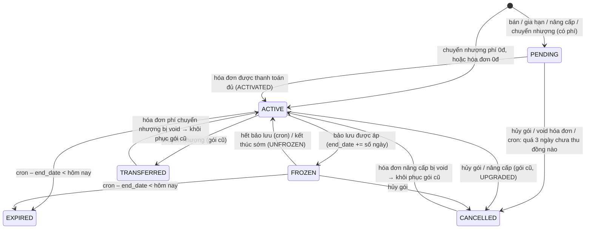
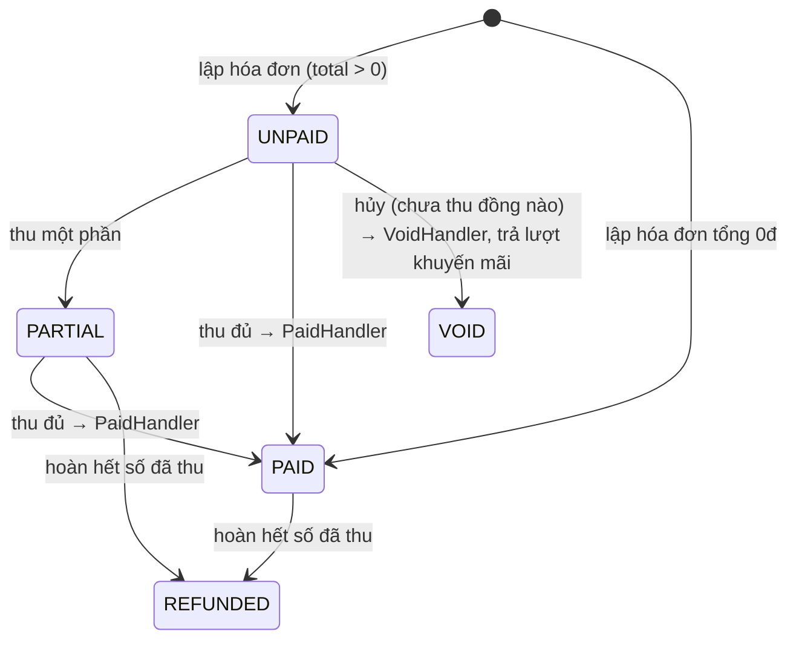
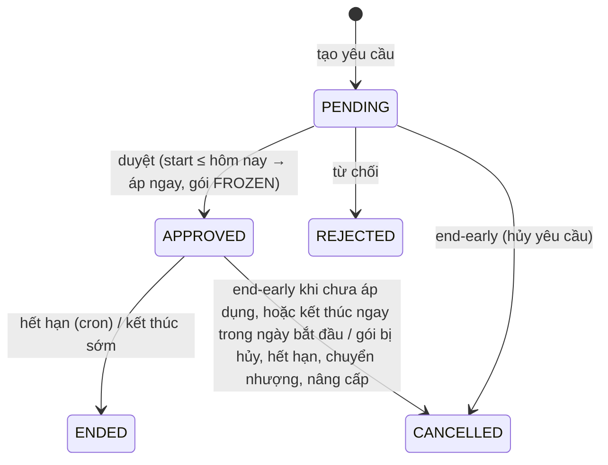

# API – Bán gói tập, đăng ký, hóa đơn, thanh toán, hoàn tiền (migration 000005)

Base URL (dev): `http://localhost:8000/v1`. Mọi endpoint cần `Authorization: Bearer <access_token>`.
Envelope, mã lỗi, phân trang: xem `sprint-01-auth-rbac-branch.md`. Tóm tắt:

- Thành công: `{ "code": 0, "message": "OK", "data": ... }`.
- Lỗi: `code` 5 chữ số, HTTP status chuẩn theo bảng trong `sprint-01-auth-rbac-branch.md`, `message` tiếng Việt hiển thị thẳng cho người dùng.
  Lỗi validate tag: `code = 51` (HTTP 400). Nghiệp vụ: `40000` (400), `40300` (403), `40400` (404), `40900` (409).
- Ngày `"YYYY-MM-DD"` (lịch Việt Nam, `Asia/Ho_Chi_Minh`). Thời điểm RFC3339. Tiền là `number` VND, đã làm tròn đến đồng.
- Danh sách: `data = {items, total, total_page, current_page, limit}`; query chung `page`, `limit` (≤100), `keyword`, `order_by`, `order_dir`.

**Phạm vi chi nhánh.** OWNER thấy toàn hệ thống. Nhân viên gắn chi nhánh chỉ xem/thao tác gói tập có `branch_id`
(chi nhánh bán) và hóa đơn có `branch_id` thuộc chi nhánh của mình; ngoài phạm vi → `40300`.

**Audit log** (`audit_logs`): `entity = subscription` (action `SELL`, `RENEW`, `UPGRADE`, `TRANSFER`, `CANCEL`),
`subscription_freeze` (`FREEZE_REQUEST`, `FREEZE_APPROVE`, `FREEZE_REJECT`, `FREEZE_END`),
`invoice` (`CREATE`, `PAYMENT`, `VOID`, `REFUND`).

## Danh sách endpoint

| Method | Path | Quyền | Mô tả |
|---|---|---|---|
| POST | `/admin/subscriptions/quote` | `subscription.sell` | Xem trước bán gói (không ghi DB) |
| POST | `/admin/subscriptions` | `subscription.sell` | Bán gói (+ thu tiền ngay) |
| GET | `/admin/subscriptions` | `subscription.view` | Danh sách đăng ký |
| GET | `/admin/subscriptions/{id}` | `subscription.view` | Chi tiết (gói, hội viên, hóa đơn, bảo lưu, lịch sử) |
| GET | `/admin/subscriptions/{id}/events` | `subscription.view` | Lịch sử vòng đời |
| GET | `/admin/members/{id}/subscriptions` | `subscription.view` | Lịch sử gói của hội viên |
| POST | `/admin/subscriptions/{id}/renew/quote` | `subscription.sell` | Xem trước gia hạn |
| POST | `/admin/subscriptions/{id}/renew` | `subscription.sell` | Gia hạn (bán gói mới nối tiếp) |
| POST | `/admin/subscriptions/{id}/upgrade/quote` | `subscription.sell` | Xem trước nâng cấp |
| POST | `/admin/subscriptions/{id}/upgrade` | `subscription.sell` | Nâng cấp gói |
| POST | `/admin/subscriptions/{id}/freezes` | `subscription.freeze` | Tạo yêu cầu bảo lưu |
| GET | `/admin/subscription-freezes` | `subscription.view` hoặc `subscription.approve_freeze` | Danh sách yêu cầu bảo lưu |
| POST | `/admin/subscription-freezes/{id}/approve` | `subscription.approve_freeze` | Duyệt bảo lưu |
| POST | `/admin/subscription-freezes/{id}/reject` | `subscription.approve_freeze` | Từ chối bảo lưu |
| POST | `/admin/subscription-freezes/{id}/end-early` | `subscription.freeze` hoặc `subscription.approve_freeze` | Kết thúc sớm / hủy yêu cầu |
| POST | `/admin/subscriptions/{id}/transfer` | `subscription.transfer` | Chuyển nhượng gói |
| POST | `/admin/subscriptions/{id}/cancel` | `subscription.cancel` | Hủy gói (+ hoàn tiền) |
| GET | `/admin/invoices` | `invoice.view` | Danh sách hóa đơn |
| GET | `/admin/invoices/{id}` | `invoice.view` | Chi tiết hóa đơn |
| GET | `/admin/invoices/{id}/print` | `invoice.view` | Dữ liệu in hóa đơn |
| POST | `/admin/invoices/{id}/payments` | `invoice.collect` | Thu tiền |
| POST | `/admin/invoices/{id}/void` | `invoice.void` | Hủy hóa đơn (chưa thu đồng nào) |
| POST | `/admin/invoices/{id}/refunds` | `invoice.refund` | Hoàn tiền |
| GET | `/admin/payments` | `invoice.view` | Sổ thu tiền (+ tổng theo phương thức) |

Quyền mặc định: OWNER, MANAGER có tất cả. RECEPTIONIST: `subscription.view/sell/freeze/transfer`, `invoice.view/collect`
(không duyệt bảo lưu, không hủy gói, không void/hoàn tiền). TRAINER: `subscription.view`.

## Enum

| Trường | Giá trị | Nhãn gợi ý |
|---|---|---|
| `subscription.status` | `PENDING` · `ACTIVE` · `FROZEN` · `EXPIRED` · `CANCELLED` · `TRANSFERRED` | Chờ thanh toán · Đang hoạt động · Bảo lưu · Hết hạn · Đã hủy · Đã chuyển nhượng |
| `freeze.status` | `PENDING` · `APPROVED` · `REJECTED` · `ENDED` · `CANCELLED` | Chờ duyệt · Đã duyệt · Từ chối · Đã kết thúc · Đã hủy |
| `invoice.status` | `UNPAID` · `PARTIAL` · `PAID` · `VOID` · `REFUNDED` | Chưa thu · Thu một phần · Đã thanh toán · Đã hủy · Đã hoàn tiền |
| `invoice.source` | `COUNTER` · `POS` · `PORTAL` | Quầy · POS · Cổng hội viên |
| `item_type` | `MEMBERSHIP` · `PT` · `PRODUCT` · `FEE` · `OTHER` | Gói tập · PT · Sản phẩm · Phí (chuyển nhượng) · Khác |
| `method` | `CASH` · `TRANSFER` · `CARD` | Tiền mặt · Chuyển khoản · Thẻ |
| `event_type` | `CREATED` · `ACTIVATED` · `RENEWED` · `UPGRADED` · `FREEZE_REQUESTED` · `FROZEN` · `UNFROZEN` · `FREEZE_REJECTED` · `TRANSFERRED` · `CANCELLED` · `EXPIRED` · `SESSION_USED` | |

## Vòng đời trạng thái

### Gói tập (subscription)

- `ACTIVE` có thể có `start_date` ở tương lai (gói nối tiếp đã thanh toán).
- Gói `PENDING` chưa cho check-in.

### Hóa đơn (invoice)

Hoàn một phần giữ nguyên `PARTIAL`/`PAID`, chỉ tăng `refunded_amount`. Bất biến DB: `total = subtotal − discount`,
`refunded_amount ≤ paid_amount ≤ total`.

### Yêu cầu bảo lưu


---

## 1. Đối tượng

### `Subscription` (dòng danh sách)
```json
{
  "id": 185,
  "member_id": 189, "member_code": "GM000189", "member_name": "Nguyễn Văn An", "member_phone": "0912345678",
  "plan_id": 2, "plan_code": "M3", "plan_name": "Gói 3 tháng", "plan_type": "TIME", "access_scope": "ALL_BRANCHES",
  "branch_id": 1, "branch_name": "GymMaster Cầu Giấy",
  "invoice_id": 1, "invoice_no": "HD26101400001", "invoice_status": "PARTIAL",
  "start_date": "2026-10-14", "end_date": "2027-01-11",
  "total_sessions": null, "remaining_sessions": null,
  "price": 1215000,
  "status": "PENDING",
  "freeze_days_used": 0, "freeze_times_used": 0,
  "previous_id": null,
  "days_left": 89,
  "sold_by": 1, "sold_by_name": "Quản trị viên",
  "note": "",
  "created_at": "2026-10-14T09:25:19.64514+07:00", "updated_at": "2026-10-14T09:25:19.644144+07:00"
}
```
- `price`: giá trị gói = số tiền thực bán sau khuyến mãi (gói nâng cấp: giá gói mới; gói nhận chuyển nhượng: giá trị còn lại). Dùng để tính giá trị còn lại khi nâng cấp.
- `total_sessions` / `remaining_sessions`: chỉ gói `SESSION`.
- `days_left` = `end_date − hôm nay`, chỉ có với `PENDING/ACTIVE/FROZEN` (còn lại `null`).
- `previous_id`: gói trước (nối tiếp / gia hạn / nâng cấp / chuyển nhượng).

### `SubscriptionDetail` (chi tiết, cũng là response của bán/gia hạn/nâng cấp/chuyển nhượng/hủy)
`Subscription` + :
```json
{
  "plan": { "id": 2, "code": "M3", "name": "Gói 3 tháng", "type": "TIME", "duration_days": 90, "session_count": null,
            "price": 1350000, "access_scope": "ALL_BRANCHES", "max_freeze_days": 15, "max_freeze_times": 1,
            "transfer_fee": 100000, "status": "ACTIVE" },
  "member": { "id": 189, "member_code": "GM000189", "full_name": "Nguyễn Văn An", "phone": "0912345678", "email": "", "status": "ACTIVE" },
  "invoice": { "...": "InvoiceDetail (mục 3) hoặc null" },
  "freezes": [ { "...": "Freeze" } ],
  "events": [
    { "id": 30, "event_type": "CREATED", "data": { "plan_id": 2, "plan_code": "M3", "start_date": "2026-10-14", "end_date": "2027-01-11", "previous_id": null, "chained": false },
      "actor_id": 1, "actor_name": "Quản trị viên", "created_at": "..." },
    { "id": 31, "event_type": "ACTIVATED", "data": { "invoice_id": 1, "invoice_no": "HD26101400001" }, "actor_id": 1, "actor_name": "Quản trị viên", "created_at": "..." }
  ]
}
```
`data` của event (JSON tự do) theo loại: `RENEWED {new_subscription_id,…}`, `UPGRADED {to_subscription_id, to_plan_id, remaining_days, remaining_value, credit}`,
`FROZEN {freeze_id, start_date, end_date, days, old_end_date, new_end_date}`, `UNFROZEN {freeze_id, early?, returned_days?, end_date}`,
`TRANSFERRED {to_subscription_id, to_member_id, transfer_fee}`, `CANCELLED {reason, refund_amount?}`, `EXPIRED {end_date}`,
`ACTIVATED {invoice_id}` hoặc `{restored: true, cancelled_subscription_id}` (khôi phục). `actor_id = null` = hệ thống (cron).

### `Freeze`
```json
{
  "id": 1, "subscription_id": 185,
  "member_id": 189, "member_code": "GM000189", "member_name": "Nguyễn Văn An",
  "plan_name": "Gói 3 tháng", "branch_id": 1, "branch_name": "GymMaster Cầu Giấy",
  "start_date": "2026-10-14", "end_date": "2026-10-18", "days": 5,
  "reason": "Ốm", "status": "APPROVED",
  "requested_by": 1, "requested_by_name": "Quản trị viên",
  "reviewed_by": 1, "reviewed_by_name": "Quản trị viên", "reviewed_at": "2026-10-14T09:27:01+07:00", "review_note": "ok",
  "created_at": "..."
}
```

---

## 2. Gói tập – `/admin/subscriptions`

### POST `/admin/subscriptions/quote` – xem trước bán gói
Body (giống bán gói, không có `payment`):
```json
{ "member_id": 189, "plan_id": 2, "branch_id": 1, "start_date": "", "promotion_code": "chaodong", "note": "" }
```
Response:
```json
{
  "member_id": 189, "branch_id": 1,
  "plan": { "...": "PlanRef" },
  "start_date": "2026-10-14", "end_date": "2027-01-11",
  "chained": false, "previous_id": null,
  "total_sessions": null,
  "subtotal": 1350000, "discount": 135000, "total": 1215000,
  "promotion": { "id": 1, "code": "CHAODONG", "name": "Chào đông – giảm 10% gói tập", "discount": 135000 }
}
```
Không ghi DB, không tăng lượt dùng mã. Lỗi giống bán gói (bao gồm các lỗi mã khuyến mãi – xem `catalog.md` §3).

### POST `/admin/subscriptions` – bán gói
```json
{
  "member_id": 189,
  "plan_id": 2,
  "branch_id": 1,
  "start_date": "",
  "promotion_code": "CHAODONG",
  "note": "Khách giới thiệu",
  "payment": { "amount": 500000, "method": "CASH", "reference": "", "note": "" }
}
```
| Trường | Bắt buộc | Ghi chú |
|---|---|---|
| `member_id` | ✔ | Hội viên phải `ACTIVE` |
| `plan_id` | ✔ | Gói phải `ACTIVE` (đang bán) |
| `branch_id` | ✔ | Chi nhánh bán (= chi nhánh được tập nếu `SINGLE_BRANCH`), phải `ACTIVE` và trong phạm vi |
| `start_date` | | ≥ hôm nay. Bỏ trống → hôm nay, **hoặc nối tiếp** (xem dưới) |
| `promotion_code` | | Mã loại `MEMBERSHIP`/`ALL` |
| `payment` | | Thu ngay: `amount` > 0 và ≤ tổng hóa đơn, `method` ∈ CASH/TRANSFER/CARD |

Trong **một transaction**: tạo subscription `PENDING` + event `CREATED` → lập hóa đơn (dòng `MEMBERSHIP`, `ref_id` = id gói, áp + tiêu thụ mã KM)
→ thu tiền (nếu có). Thu đủ → gói `ACTIVE` + event `ACTIVATED`. Response: `SubscriptionDetail`.

**Nối gói.** Không truyền `start_date` và hội viên còn gói `ACTIVE/FROZEN` chưa hết hạn **cùng phạm vi**
(cùng `access_scope`; nếu `SINGLE_BRANCH` thì cùng chi nhánh) → `start_date` = `end_date` muộn nhất + 1, `previous_id` = gói đó.
`end_date = start_date + duration_days − 1`. Gói `SESSION`: `total_sessions = remaining_sessions = session_count`.

Lỗi: `40000 "Ngày bắt đầu không được ở quá khứ"`, `"Hội viên đang không hoạt động"`, `"Gói tập … đã ngừng bán"`,
`"Chi nhánh đang ngừng hoạt động"`, `"Số tiền thu vượt quá số còn nợ (1.215.000 đ)"`, lỗi mã khuyến mãi;
`40300 "Bạn không có quyền bán gói tại chi nhánh này"`; `40400 "Không tìm thấy hội viên" | "Không tìm thấy gói tập"`.

### GET `/admin/subscriptions`
| Query | Mô tả |
|---|---|
| `branch_id` | Chi nhánh bán (ngoài phạm vi → 40300) |
| `member_id`, `plan_id` | |
| `status` | `PENDING` … `TRANSFERRED` |
| `expiring_in_days` | Gói `ACTIVE/FROZEN` có `end_date` trong [hôm nay, hôm nay + N] (0 = bỏ qua) |
| `from`, `to` | Lọc `end_date` trong khoảng (tính cả hai đầu) |
| `keyword` | Tên/SĐT/mã hội viên, tên gói, số hóa đơn |
| `order_by` | `id` (mặc định), `start_date`, `end_date`, `created_at`, `price`, `status` |

Response: `{ items: Subscription[], total, … }`.

### GET `/admin/subscriptions/{id}` → `SubscriptionDetail`. Không có → `40400 "Không tìm thấy gói tập của hội viên"`.
### GET `/admin/subscriptions/{id}/events` → `Event[]` (cũ → mới).
### GET `/admin/members/{id}/subscriptions` → `Subscription[]` (mới nhất trước)
Hội viên thuộc chi nhánh của nhân viên → thấy mọi gói; ngược lại chỉ thấy gói bán tại chi nhánh trong phạm vi.

### POST `/admin/subscriptions/{id}/renew` · `/renew/quote` – gia hạn
```json
{ "plan_id": 0, "promotion_code": "", "note": "", "payment": { "amount": 500000, "method": "CASH" } }
```
- `plan_id` bỏ trống/0 = gói hiện tại. Gói hiện tại phải `ACTIVE`, `FROZEN` hoặc `EXPIRED`.
- = bán gói mới cho cùng hội viên, cùng chi nhánh; bắt đầu từ `max(hôm nay, end_date cũ + 1, end_date gói cùng phạm vi muộn nhất + 1)`;
  `previous_id` = gói được nối (mặc định là gói gia hạn). Ghi event `RENEWED` trên gói cũ, audit `RENEW`.
- `/renew/quote` trả `QuoteRes` (không có `payment`). Response gia hạn: `SubscriptionDetail` của **gói mới**.

### POST `/admin/subscriptions/{id}/upgrade/quote` – xem trước nâng cấp
Body `{ "plan_id": 3 }`. Response:
```json
{
  "subscription_id": 186,
  "current_plan": { "...": "PlanRef" }, "new_plan": { "...": "PlanRef" },
  "current_price": 1215000,
  "total_days": 90, "remaining_days": 90,
  "total_sessions": null, "remaining_sessions": null,
  "remaining_value": 1215000,
  "new_price": 4800000,
  "amount_due": 3585000,
  "start_date": "2026-10-14", "end_date": "2027-10-13"
}
```
### POST `/admin/subscriptions/{id}/upgrade` – nâng cấp
```json
{ "plan_id": 3, "note": "", "payment": { "amount": 3585000, "method": "TRANSFER", "reference": "FT2610" } }
```
- Gói cũ phải `ACTIVE`; gói mới phải đang bán và khác gói cũ.
- **Giá trị còn lại** = `price × ngày còn lại / tổng ngày` (ngày còn lại tính cả hôm nay; gói chưa bắt đầu = toàn bộ);
  gói `SESSION` = `price × buổi còn lại / tổng buổi`.
- Hóa đơn mới: dòng `MEMBERSHIP` `unit_price` = giá gói mới, `discount` = min(giá trị còn lại, giá gói mới),
  mô tả `"Nâng cấp M3 → M12 (…), khấu trừ giá trị còn lại gói cũ 1.215.000 đ"` → `total = max(0, giá mới − giá trị còn lại)`.
  Tổng 0đ → hóa đơn `PAID`, gói mới `ACTIVE` ngay.
- Gói cũ → `CANCELLED` (event `UPGRADED`), yêu cầu bảo lưu đang mở bị hủy. Gói mới bắt đầu hôm nay, `previous_id` = gói cũ.
- Nếu hóa đơn nâng cấp bị **void** (chưa thu) → gói mới `CANCELLED` và gói cũ được **khôi phục** (`ACTIVE`, hoặc `EXPIRED` nếu đã quá hạn).

Lỗi: `40000 "Chỉ nâng cấp được gói đang hoạt động"`, `"Gói mới phải khác gói hiện tại"`.

### POST `/admin/subscriptions/{id}/freezes` – yêu cầu bảo lưu
```json
{ "start_date": "2026-10-20", "end_date": "2026-10-26", "reason": "Đi công tác" }
```
Quy tắc (theo thứ tự): gói `ACTIVE`; gói cho phép bảo lưu (`max_freeze_days`, `max_freeze_times` > 0);
`start_date ≥ hôm nay`; `end_date ≥ start_date`; `start_date` nằm trong [start_date, end_date] của gói;
không chồng lấn yêu cầu `PENDING/APPROVED` khác; **cộng dồn** (đã dùng + đang chờ/đã duyệt chưa áp) ≤ `max_freeze_times` lần và ≤ `max_freeze_days` ngày.
Tạo `PENDING` + event `FREEZE_REQUESTED`; gửi thông báo `FREEZE_REQUEST` cho người có quyền `subscription.approve_freeze` của chi nhánh. Response: `Freeze`.

Lỗi: `40000 "Gói tập này không cho phép bảo lưu"`, `"Ngày bắt đầu bảo lưu phải từ hôm nay trở đi"`,
`"Gói tập đã dùng hết 1 lần bảo lưu cho phép"`, `"Vượt quá số ngày bảo lưu cho phép: tối đa 15 ngày, đã dùng/đăng ký 5 ngày, còn 10 ngày"`;
`40900 "Khoảng bảo lưu bị trùng với yêu cầu bảo lưu khác (…)"`.

### GET `/admin/subscription-freezes`
Query: `status`, `branch_id`, `subscription_id`, `keyword` (tên/SĐT/mã hội viên), `order_by` (`id`, `start_date`, `end_date`, `created_at`, `status`).
Màn hình chờ duyệt: `?status=PENDING&branch_id=1`. Response `{ items: Freeze[], … }`.

### POST `/admin/subscription-freezes/{id}/approve` · `/reject`
Body `{ "note": "Đồng ý" }`. Chỉ yêu cầu `PENDING` (khác → `40900 "Yêu cầu bảo lưu đã được xử lý"`).
- **Duyệt**: gói phải `ACTIVE/FROZEN`, `end_date` của yêu cầu chưa qua. Nếu `start_date ≤ hôm nay` → **áp ngay**:
  gói `FROZEN`, `end_date += days`, `freeze_days_used += days`, `freeze_times_used += 1`, event `FROZEN`.
  Ngược lại cron sẽ áp khi đến ngày.
- **Từ chối**: `REJECTED`, event `FREEZE_REJECTED`.
- Hội viên có tài khoản cổng nhận thông báo `FREEZE_RESULT`. Response: `Freeze`.

### POST `/admin/subscription-freezes/{id}/end-early`
Body `{ "note": "" }`.
- Yêu cầu `PENDING` hoặc `APPROVED` chưa áp → `CANCELLED` (không ảnh hưởng gói).
- Đang áp dụng → hội viên tập lại **từ hôm nay**: số ngày chưa dùng `unused = end_date − hôm nay + 1`;
  gói `ACTIVE`, `end_date −= unused`, `freeze_days_used −= unused`; bảo lưu `ENDED` với `end_date = hôm qua`
  (nếu bảo lưu bắt đầu đúng hôm nay → `CANCELLED`, trả lại cả 1 lần). Event `UNFROZEN {early: true, returned_days}`.

### POST `/admin/subscriptions/{id}/transfer` – chuyển nhượng
```json
{ "to_member_id": 190, "note": "", "payment": { "amount": 100000, "method": "CASH" } }
```
- Gói `ACTIVE`, chưa hết hạn, còn buổi; người nhận khác người chuyển và `ACTIVE`.
- Gói mới cho người nhận: từ `max(hôm nay, start_date cũ)` đến `end_date` cũ, cùng gói/chi nhánh, `remaining_sessions` cũ
  (`total_sessions` = số buổi còn lại), `price` = giá trị còn lại, kế thừa số ngày/lần bảo lưu đã dùng, `previous_id` = gói cũ.
- Gói cũ → `TRANSFERRED` (event `TRANSFERRED`).
- Phí = `plan.transfer_fee`: > 0 → hóa đơn cho **người nhận** với dòng `FEE` (`ref_id` = gói mới); gói mới `PENDING` đến khi thu đủ phí.
  Phí 0 → gói mới `ACTIVE` ngay, không có hóa đơn. Void hóa đơn phí (chưa thu) → hoàn tác: gói mới `CANCELLED`, gói cũ `ACTIVE` lại.
- Response: `SubscriptionDetail` của gói mới.

Lỗi: `40000 "Không thể chuyển nhượng cho chính hội viên đang sở hữu gói"`, `"Hội viên nhận chuyển nhượng đang không hoạt động"`,
`"Chỉ chuyển nhượng được gói đang hoạt động"`.

### POST `/admin/subscriptions/{id}/cancel` – hủy gói
```json
{ "reason": "Chuyển công tác", "refund": { "amount": 500000, "method": "CASH" } }
```
- Gói `PENDING/ACTIVE/FROZEN` (khác → `40000 "Gói tập đã kết thúc, không thể hủy"`).
- Gói `PENDING` có hóa đơn chưa thu đồng nào và không hoàn tiền → hóa đơn bị **void** (trả lượt KM), gói `CANCELLED`.
- Ngược lại: hoàn tiền trước (nếu có, qua `InvoiceService.Refund` trên hóa đơn của gói – lỗi hoàn tiền làm rollback cả thao tác),
  gói `CANCELLED`, hủy các yêu cầu bảo lưu đang mở, event `CANCELLED {reason, refund_amount}`.
- Gói nhận chuyển nhượng: hóa đơn của gói là hóa đơn **phí chuyển nhượng**.

---

## 3. Hóa đơn & thanh toán – `/admin/invoices`, `/admin/payments`

### `Invoice` (dòng danh sách)
```json
{
  "id": 1, "invoice_no": "HD26101400001",
  "member_id": 189, "member": { "id": 189, "member_code": "GM000189", "full_name": "Nguyễn Văn An", "phone": "0912345678" },
  "branch_id": 1, "branch_name": "GymMaster Cầu Giấy",
  "subtotal": 1350000, "discount": 135000, "total": 1215000,
  "paid_amount": 1215000, "refunded_amount": 0, "due": 0,
  "status": "PAID", "source": "COUNTER",
  "promotion_id": 1, "promotion_code": "CHAODONG",
  "note": "", "issued_by": 1, "issued_by_name": "Quản trị viên", "issued_at": "2026-10-14T09:25:19+07:00",
  "voided_at": null, "void_reason": "", "created_at": "..."
}
```
`member = null` với khách vãng lai (POS). `due = total − paid_amount` (0 khi `VOID`).

### `InvoiceDetail` = `Invoice` +
```json
{
  "voided_by_name": "",
  "items": [
    { "id": 1, "item_type": "MEMBERSHIP", "ref_id": 185, "description": "Gói M3 – Gói 3 tháng (14/10/2026 - 11/01/2027)",
      "quantity": 1, "unit_price": 1350000, "discount": 135000, "amount": 1215000 }
  ],
  "payments": [
    { "id": 1, "invoice_id": 1, "amount": 500000, "method": "CASH", "reference": "", "paid_at": "...",
      "received_by": 1, "received_by_name": "Quản trị viên", "note": "" }
  ],
  "refunds": [
    { "id": 1, "invoice_id": 2, "amount": 1, "method": "CASH", "reason": "x", "refunded_by": 1, "refunded_by_name": "Quản trị viên", "created_at": "..." }
  ]
}
```
Dòng hóa đơn: `amount = quantity × unit_price − discount`; `discount` của dòng gồm giảm riêng + phần khuyến mãi được **phân bổ** theo tỷ lệ thành tiền.

### GET `/admin/invoices`
Query: `branch_id`, `member_id`, `status`, `source`, `from`, `to` (ngày lập, giờ VN, tính cả hai đầu),
`keyword` (số HĐ, tên/SĐT/mã hội viên), `order_by` (`id`, `issued_at`, `total`, `paid_amount`, `invoice_no`, `status`).

### GET `/admin/invoices/{id}` → `InvoiceDetail`. Không có → `40400 "Không tìm thấy hóa đơn"`; ngoài phạm vi → `40300`.

### POST `/admin/invoices/{id}/payments` – thu tiền
```json
{ "amount": 715000, "method": "TRANSFER", "reference": "FT123", "note": "" }
```
Khóa hóa đơn (`SELECT … FOR UPDATE`) → không thu quá số còn nợ, hai request đồng thời không làm `paid_amount` vượt `total`.
Thu đủ → `PAID` và gói tập liên quan được kích hoạt. Response: `InvoiceDetail`.
Lỗi `40000`: `"Số tiền thu vượt quá số còn nợ (715.000 đ)"`, `"Hóa đơn đã được thanh toán đủ"`, `"Hóa đơn đã bị hủy, không thể thu tiền"`.

### POST `/admin/invoices/{id}/void` – hủy hóa đơn
Body `{ "reason": "Khách đổi ý" }`. Chỉ khi `UNPAID` (chưa thu đồng nào). Trả lại 1 lượt mã khuyến mãi; gói `PENDING` của hóa đơn → `CANCELLED`
(khôi phục gói cũ nếu là nâng cấp/chuyển nhượng). Response: `InvoiceDetail`.
Lỗi: `40000 "Hóa đơn đã thu tiền nên không thể hủy, hãy dùng chức năng hoàn tiền"`, `40900 "Hóa đơn đã bị hủy trước đó"`.

### POST `/admin/invoices/{id}/refunds` – hoàn tiền
```json
{ "amount": 200000, "method": "CASH", "reason": "Hoàn phí" }
```
`amount ≤ paid_amount − refunded_amount`; hoàn hết → `REFUNDED`. Hoàn tiền **không** tự hủy gói tập (muốn hủy gói kèm hoàn tiền: dùng `/subscriptions/{id}/cancel`).
Lỗi: `40000 "Số tiền hoàn vượt quá số tiền có thể hoàn (100.000 đ)"`, `"Hóa đơn chưa thu tiền nên không có gì để hoàn"`, `"Hóa đơn đã được hoàn tiền toàn bộ"`.

### GET `/admin/invoices/{id}/print` – dữ liệu in
```json
{
  "invoice": { "...": "InvoiceDetail" },
  "branch": { "id": 1, "code": "HN01", "name": "GymMaster Cầu Giấy", "address": "144 Xuân Thủy, Cầu Giấy, Hà Nội", "phone": "02437547461", "email": "" },
  "member": { "id": 189, "member_code": "GM000189", "full_name": "Nguyễn Văn An", "phone": "0912345678" },
  "total_in_words": "Một triệu hai trăm mười lăm nghìn đồng",
  "due_in_words": "Không đồng",
  "printed_at": "2026-10-14T09:30:00+07:00",
  "printed_by_name": "Quản trị viên"
}
```

### GET `/admin/payments` – sổ thu tiền
Query: `branch_id` (chi nhánh của hóa đơn), `method`, `from`, `to` (ngày thu, giờ VN), `received_by` (users.id),
`keyword` (số HĐ, tên/SĐT hội viên, mã giao dịch), `order_by` (`id`, `paid_at`, `amount`, `method`).
```json
{
  "items": [
    { "id": 3, "invoice_id": 2, "amount": 100000, "method": "CASH", "reference": "", "paid_at": "...",
      "received_by": 1, "received_by_name": "Quản trị viên", "note": "",
      "invoice_no": "HD26101400002", "branch_id": 1, "branch_name": "GymMaster Cầu Giấy",
      "member_id": 190, "member_code": "GM000190", "member_name": "Trần Thị Bình" }
  ],
  "total": 3, "total_page": 1, "current_page": 1, "limit": 10,
  "summary": {
    "total_amount": 1315000, "count": 3,
    "by_method": [
      { "method": "CASH", "amount": 600000, "count": 2 },
      { "method": "TRANSFER", "amount": 715000, "count": 1 },
      { "method": "CARD", "amount": 0, "count": 0 }
    ]
  }
}
```
`summary` tính trên **toàn bộ** bộ lọc (không chỉ trang hiện tại). Sổ thu chỉ gồm các lần thu (không trừ hoàn tiền).

---

## 4. Tác vụ định kỳ (cron) – `service.SubscriptionService`
Lấy từ `module.Deps.Subscriptions`. `today` là ngày Việt Nam (truyền `time.Now()` cũng được).
```go
// ACTIVE/FROZEN có end_date < today → EXPIRED (+ event, hủy yêu cầu bảo lưu đang mở);
// PENDING tạo trước 00:00 ngày (today − 3) mà hóa đơn chưa thu đồng nào → void hóa đơn → CANCELLED.
// Trả số gói đã đổi trạng thái.
ExpireDue(ctx context.Context, today time.Time) (int, error)
// Kết thúc bảo lưu hết hạn (FROZEN → ACTIVE, freeze ENDED) rồi áp bảo lưu APPROVED đến ngày (ACTIVE → FROZEN).
ApplyDueFreezes(ctx context.Context, today time.Time) (int, error)
// Gói ACTIVE có end_date = today + d (d ∈ days) và CHƯA có gói nối tiếp → danh sách nhắc gia hạn
// (member_user_id, email, phone… để gửi mail/thông báo). days thường lấy từ Settings `subscription.remind_before_days`.
ListExpiring(ctx context.Context, days []int, today time.Time) ([]repository.ExpiringSubscription, error)
```
Gợi ý lịch 00:05: `ApplyDueFreezes` → `ExpireDue` → `ListExpiring`.

## 5. Cổng hội viên – service (chưa có route, module cổng hội viên gọi)
```go
ListMemberSubscriptions(ctx, memberID uint) ([]*v1.Subscription, error)
ListMemberInvoices(ctx, memberID uint, page dto.PageReq) (*invoicev1.ListRes, error)
RequestFreezeByMember(ctx, memberID, subscriptionID uint, in v1.FreezeInput) (*v1.Freeze, error) // cùng quy tắc mục 2
```

---

## 6. Hướng dẫn module khác dùng `InvoiceService` (PT, POS…)

`InvoiceService` được tạo **một lần** trong `internal/cmd/cmd.go` và chia sẻ qua `module.Deps.Invoices`
(`Deps.Promotions` là `PromotionService` dùng chung). File: `internal/service/invoice_service.go`.

```go
type InvoiceDraft struct {
    MemberID      *uint  // nil = khách vãng lai (chỉ hợp lệ khi Source = POS)
    BranchID      uint   // phải thuộc phạm vi người dùng
    Source        string // COUNTER (mặc định) | POS | PORTAL
    Items         []InvoiceItemDraft
    PromotionCode string // tùy chọn; khi có thì AppliesTo bắt buộc
    AppliesTo     string // MEMBERSHIP | PT | PRODUCT
    Note          string
}
type InvoiceItemDraft struct {
    ItemType    string  // MEMBERSHIP | PT | PRODUCT | FEE | OTHER
    RefID       *uint   // id bản ghi nghiệp vụ (pt_contracts.id, products.id…)
    Description string
    Quantity    int     // 0 = 1
    UnitPrice   float64
    Discount    float64 // giảm riêng của dòng (không gồm khuyến mãi)
}
type PaymentInput struct { Amount float64; Method, Reference, Note string }
type RefundInput  struct { Amount float64; Method, Reason string }
type InvoiceItemHandler func(ctx context.Context, inv *entity.Invoice, item *entity.InvoiceItem) error

Preview(ctx, draft) (*InvoicePreview, error)                        // tính tiền, không ghi DB (màn hình báo giá)
CreateInvoice(ctx, draft) (*entity.Invoice, error)                  // trả kèm inv.Items
AddPayment(ctx, invoiceID uint, in PaymentInput) (*entity.Invoice, error)
Void(ctx, invoiceID uint, reason string) error
Refund(ctx, invoiceID uint, in RefundInput) (*entity.Invoice, error)
RegisterPaidHandler(itemType string, h InvoiceItemHandler)
RegisterVoidHandler(itemType string, h InvoiceItemHandler)
FindInvoice(ctx, id) (*entity.Invoice, error)
Get / Detail / List / ListPayments / Print / ListByMember            // truy vấn (Detail không kiểm tra phạm vi)
```

**Cách tính:** `subtotal = Σ quantity × unit_price`; khuyến mãi được `Validate` trên `subtotal − Σ giảm theo dòng`,
`Consume` (tăng `used_count`) **trong cùng transaction**, rồi phân bổ vào các dòng theo tỷ lệ thành tiền (phần lẻ dồn dòng lớn nhất);
`discount = Σ giảm theo dòng + khuyến mãi`; `total = subtotal − discount`. Tiền làm tròn đến đồng. Hóa đơn tổng 0đ → `PAID` ngay và gọi PaidHandler.

**Handler:** gọi cho **từng dòng** có `item_type` tương ứng, **trong transaction** của thao tác; trả lỗi → rollback toàn bộ (kể cả lần thu tiền).
`inv` là trạng thái hóa đơn sau thay đổi. Handler nên **idempotent** (kiểm tra trạng thái bản ghi trước khi đổi).
Đã đăng ký: `MEMBERSHIP` và `FEE` (module gói tập – `ref_id` = `subscriptions.id`; FEE dành riêng cho phí chuyển nhượng gói,
module khác dùng `OTHER` cho phí khác).

**Ví dụ – module PT:**
```go
func RegisterPT(d *Deps, admin *ghttp.RouterGroup) {
    contracts := repository.NewPTContractRepository(d.DB)
    // 1) Đăng ký MỘT lần khi khởi tạo module.
    d.Invoices.RegisterPaidHandler(entity.InvoiceItemPT, func(ctx context.Context, inv *entity.Invoice, it *entity.InvoiceItem) error {
        return contracts.ActivateIfPending(ctx, *it.RefID)      // PENDING → ACTIVE
    })
    d.Invoices.RegisterVoidHandler(entity.InvoiceItemPT, func(ctx context.Context, inv *entity.Invoice, it *entity.InvoiceItem) error {
        return contracts.CancelIfPending(ctx, *it.RefID)
    })
    ...
}

// 2) Trong service bán PT: tạo bản ghi nghiệp vụ trước, rồi lập hóa đơn trỏ tới nó – cùng một transaction.
err := s.tx.WithTx(ctx, func(ctx context.Context) error {
    c := &entity.PTContract{MemberID: memberID, Status: "PENDING", ...}
    if err := s.repo.Create(ctx, c); err != nil { return err }
    inv, err := s.invoices.CreateInvoice(ctx, service.InvoiceDraft{
        MemberID: &memberID, BranchID: branchID,
        Items: []service.InvoiceItemDraft{{ItemType: entity.InvoiceItemPT, RefID: &c.ID,
            Description: "PT 10 buổi – HLV Nguyễn B", UnitPrice: pkg.Price}},
        PromotionCode: req.PromotionCode, AppliesTo: entity.AppliesPT,
    })
    if err != nil { return err }
    if err := s.repo.SetInvoice(ctx, c.ID, inv.ID); err != nil { return err }
    if req.Payment != nil {                       // thu đủ → PaidHandler kích hoạt hợp đồng (trong cùng tx)
        _, err = s.invoices.AddPayment(ctx, inv.ID, service.PaymentInput{Amount: req.Payment.Amount, Method: req.Payment.Method})
    }
    return err
})
```
**POS** (khách vãng lai): `MemberID: nil, Source: entity.InvoiceSourcePOS`, nhiều dòng `PRODUCT` (`RefID` = products.id, `Quantity`),
thường gọi `AddPayment` đủ tiền ngay; trừ tồn kho trong PaidHandler `PRODUCT` hoặc trực tiếp trong transaction bán.

Lưu ý:
- Mọi hàm ghi tự mở transaction nếu ctx chưa có; gọi bên trong `d.Tx.WithTx` thì dùng chung transaction (`postgres.Conn`).
- `AddPayment`, `Void`, `Refund` khóa hóa đơn `FOR UPDATE`, kiểm tra phạm vi chi nhánh, ghi audit `invoice`.
- Mã lỗi nghiệp vụ trả `rescode.BadRequest/Conflict/NotFound/PermissionDenied` với thông điệp tiếng Việt – trả thẳng cho client.
- Đọc số tiền thành chữ: `service.VNDInWords(1215000)` → `"Một triệu hai trăm mười lăm nghìn đồng"`, `service.NumberToVietnameseWords(n)`.

## 7. Ghi chú / giới hạn hiện tại
- Nối gói chỉ xét gói `ACTIVE/FROZEN` (không xét `PENDING`). Bảo lưu áp vào gói cũ sau khi đã bán gói nối tiếp có thể làm hai gói chồng ngày – không tự dời gói nối tiếp.
- Hủy gói không tự dời các gói nối tiếp phía sau.
- Gói `PENDING` đã thu một phần không bị cron hủy (cần thu nốt hoặc hoàn tiền + hủy).
