# Sơ đồ Thiết kế Hệ thống Mở rộng (Giai đoạn 2 – 4, Mục 16.4)

Tài liệu này tổng hợp đầy đủ các sơ đồ **Use Case**, **Sequence**, **Activity**, **State Machine** và **ERD** theo yêu cầu tại Mục 16.4 của `docs/PLAN.md` để đưa vào quyển báo cáo đồ án.

---

## 1. Sơ đồ Use Case Mở rộng

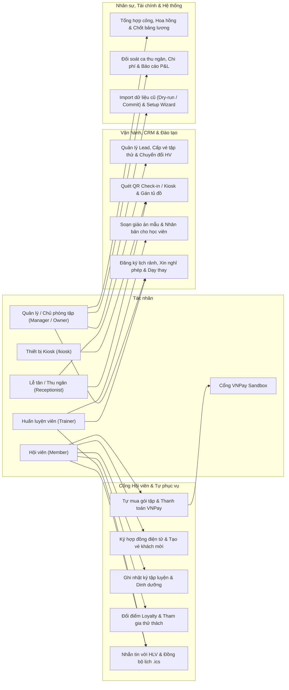

---

## 2. Sơ đồ Tuần tự (Sequence Diagrams)

### 2.1 Thanh toán trực tuyến VNPay (Redirect → IPN Webhook → Kích hoạt gói)

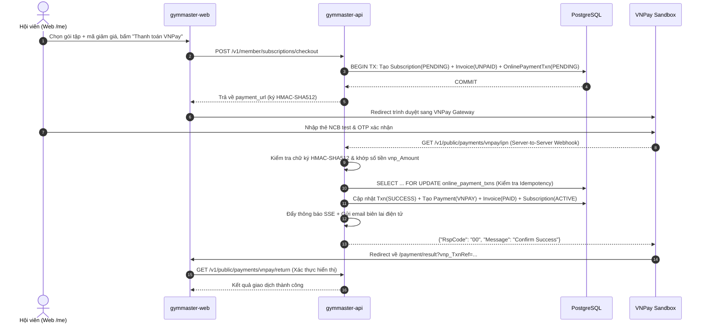

### 2.2 Luồng Quên mật khẩu & Đặt lại mật khẩu an toàn

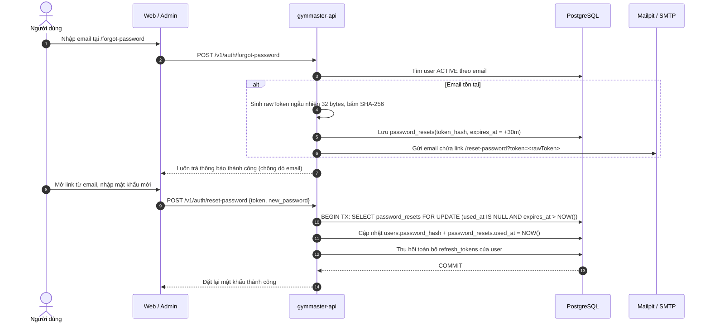

### 2.3 Check-in qua Thiết bị Kiosk (`/kiosk`)

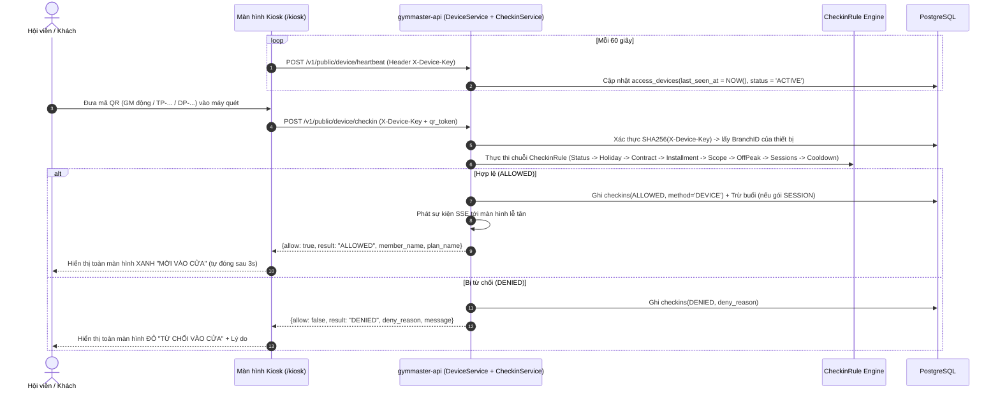

### 2.4 Xác thực 2 lớp (2FA TOTP – RFC 6238)

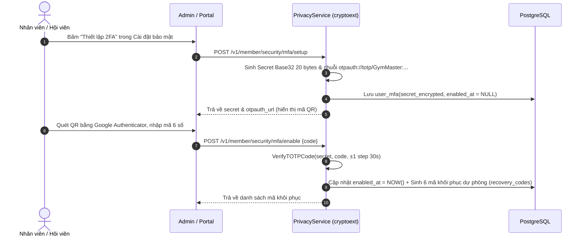

---

## 3. Sơ đồ Hoạt động (Activity Diagrams)

### 3.1 Vòng đời Khách tiềm năng CRM (`NEW` → `CONVERTED` / `LOST`)

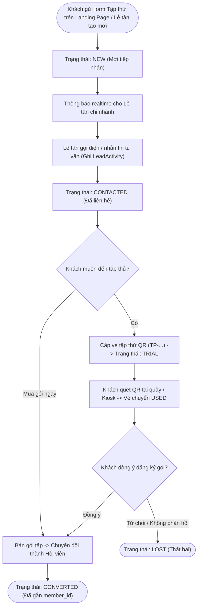

### 3.2 Quy trình Trả góp & Kiểm soát Quá hạn Check-in

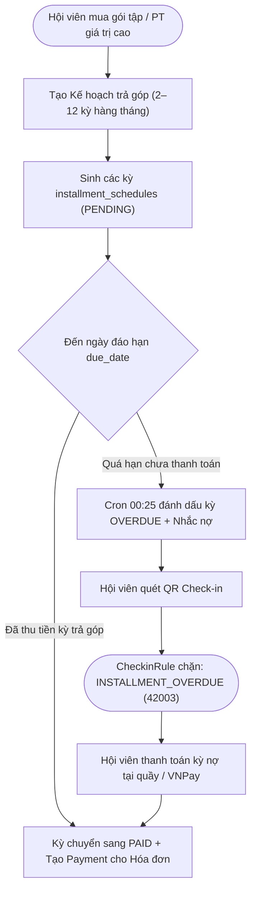

---

## 4. Sơ đồ Trạng thái (State Diagrams)

### 4.1 Giao dịch Thanh toán Trực tuyến (`online_payment_txns`)
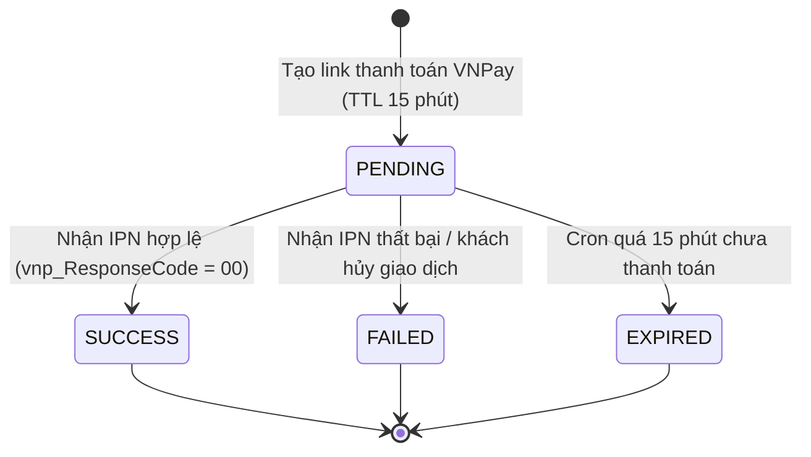

### 4.2 Bảng lương Nhân sự (`payrolls`)
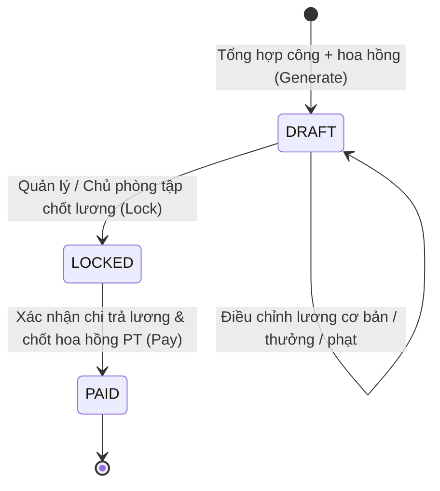

### 4.3 Yêu cầu Dữ liệu Cá nhân – Nghị định 13/2023 (`data_requests`)
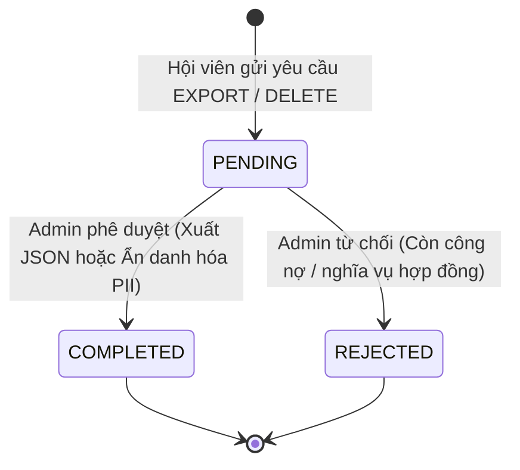

---

## 5. Sơ đồ Thực thể Liên kết Mở rộng (ERD – Giai đoạn 2 đến 4)

```mermaid
erDiagram
    MEMBERS ||--o{ SUBSCRIPTIONS : "đăng ký"
    MEMBERS ||--o{ WORKOUT_PLANS : "nhận giáo án"
    MEMBERS ||--o{ WORKOUT_LOGS : "ghi nhật ký tập"
    MEMBERS ||--o{ REVIEWS : "đánh giá"
    MEMBERS ||--o{ LOYALTY_LEDGERS : "tích/đổi điểm"
    MEMBERS ||--o{ MEMBER_BADGES : "đạt huy hiệu"
    MEMBERS ||--o{ CHALLENGE_PARTICIPANTS : "tham gia"
    MEMBERS ||--o{ FOOD_LOGS : "ghi bữa ăn"
    MEMBERS ||--o{ MEMBER_CONTRACTS : "ký e-contract"
    MEMBERS ||--o{ DAY_PASSES : "mời khách"
    MEMBERS ||--o{ CONSENTS : "đồng ý NĐ13"
    MEMBERS ||--o{ DATA_REQUESTS : "yêu cầu dữ liệu"
    MEMBERS ||--o{ MEMBER_BRANCH_TRANSFERS : "chuyển chi nhánh"

    INVOICES ||--o{ ONLINE_PAYMENT_TXNS : "thanh toán VNPay"
    INVOICES ||--o| INSTALLMENT_PLANS : "trả góp"
    INSTALLMENT_PLANS ||--|{ INSTALLMENT_SCHEDULES : "kỳ thanh toán"

    BRANCHES ||--o{ ACCESS_DEVICES : "thiết bị Kiosk/Cổng"
    BRANCHES ||--o{ LOCKERS : "tủ đồ"
    LOCKERS ||--o{ LOCKER_RENTALS : "lượt thuê"
    BRANCHES ||--o{ EQUIPMENTS : "thiết bị tập"
    EQUIPMENTS ||--o{ MAINTENANCE_LOGS : "bảo trì"
    BRANCHES ||--o{ PAYROLLS : "bảng lương"
    PAYROLLS ||--|{ PAYROLL_ITEMS : "dòng lương NV"
    BRANCHES ||--o{ EXPENSES : "chi phí"
    BRANCHES ||--o{ CASH_SESSIONS : "ca thu ngân"
    BRANCHES ||--o{ BRANCH_HOLIDAYS : "lịch nghỉ lễ"
    BRANCHES ||--o{ SALES_TARGETS : "chỉ tiêu KPI"
    BRANCHES ||--o{ LEGACY_IMPORT_JOBS : "import dữ liệu cũ"

    PT_CONTRACTS ||--o| CONVERSATIONS : "kênh chat PT"
    CONVERSATIONS ||--o{ MESSAGES : "tin nhắn"
    USERS ||--o| USER_MFA : "bảo mật 2FA"
    USERS ||--o| TRAINER_PUBLIC_PROFILES : "hồ sơ HLV công khai"
    USERS ||--o{ NOTIFICATION_PREFERENCES : "tùy chọn thông báo"
```
